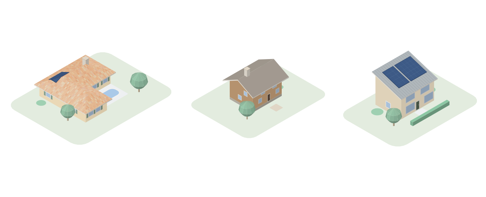
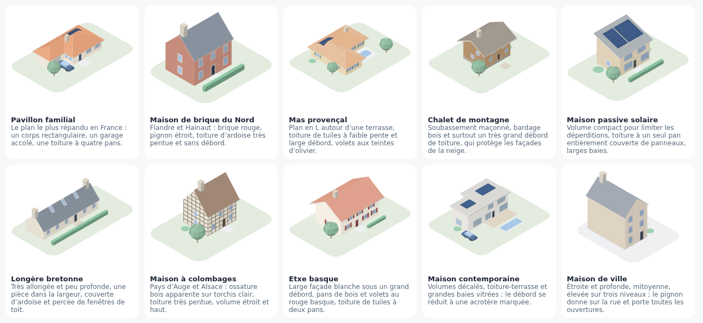
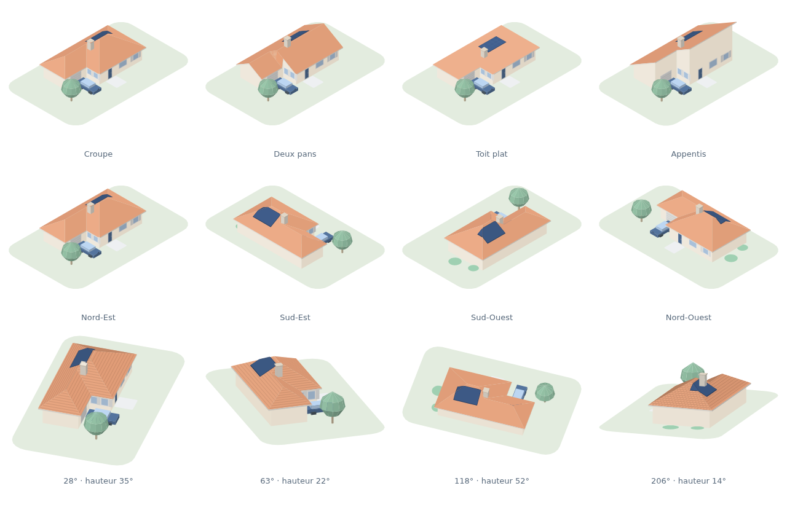
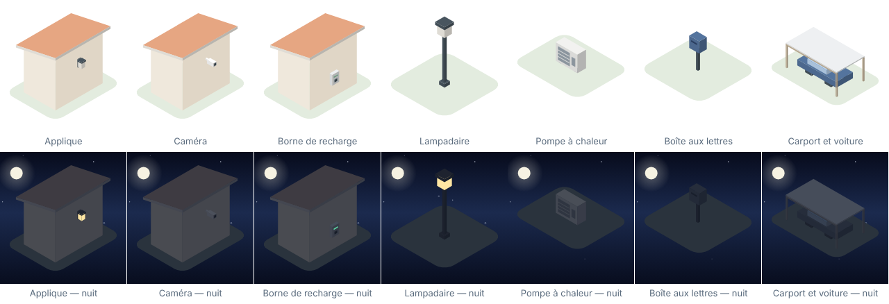
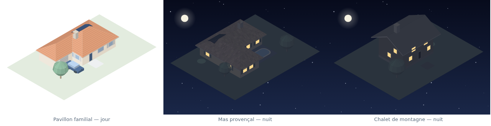
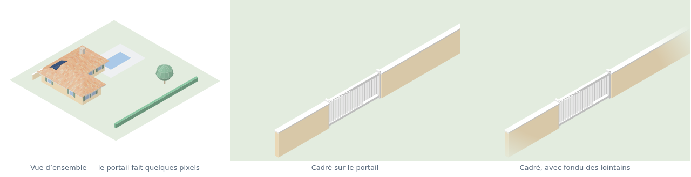
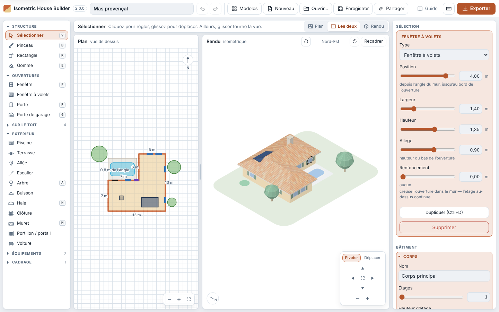
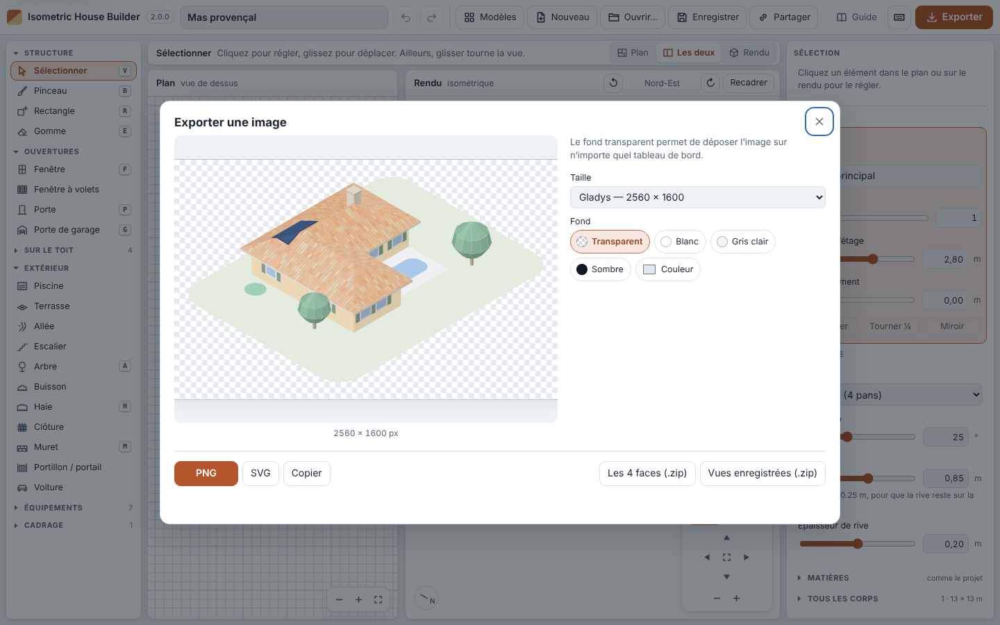

[Version française](README.md)

# Isometric House Builder

Model your house in isometric view and export it as PNG or SVG illustrations,
ready to sit on a home-automation dashboard.



**[▶ Open the application](https://guim31.github.io/isometric-house-builder/)**
 · **[📖 Getting-started guide](https://guim31.github.io/isometric-house-builder/guide.en.html)**

Nothing to install, everything happens in the browser, and no data is sent
anywhere. The interface is in French and English: a selector in the header,
and the browser's language by default.

---

## Why this tool

There are already excellent isometric house builders, but they are either
paid, closed, or designed for play rather than for producing a reusable image.
This one makes three choices:

- **Free and open source**, under the MIT licence, with no account and no
  upload.
- **The image is the finished product.** PNG export with a transparent
  background at up to 4×, vector SVG export, and all four sides of the house
  in one click.
- **No build step.** No Node, no bundler, no dependencies: ES modules and an
  `index.html` file. Clone it, open it, it works — and anyone can read the code
  without any tooling.

It was first made to illustrate a house in
[Gladys Assistant](https://gladysassistant.com/), but the export is ordinary
PNG and SVG: Home Assistant, Jeedom, a wiki or a slide deck will do just as
well.

## Ten templates to start from



The tool opens on a gallery rather than an empty grid. The ten templates cover
deliberately contrasting styles — family house, Northern brick house, Provençal
farmhouse, mountain chalet, passive solar house, Breton longhouse,
half-timbered house, Basque etxe, contemporary house, townhouse — because what
sets one region apart lies more in the pitch of the roof, the depth of the
overhang and the number of storeys than in the colour of the walls. Take the
one closest to yours and reshape it: it is quicker than starting from nothing.
The **Templates** button reopens the gallery at any time, and *Blank page* is
always there.

## What the tool can do



| | |
|---|---|
| **Volumes** | Several **independent building volumes** — house, garage, garden shed — each with its own roof, height, materials and colours |
| **Volume** | Footprint drawn freehand on a 1 m or 0.50 m grid, up to 4 storeys — each with **its own height**, for an attic floor — and an adjustable plinth |
| **Dimensions** | Length shown on every stretch of wall, live dimensions while drawing, footprint and area in the inspector |
| **Roof** | Hip, gable, lean-to, flat — pitch, overhang and fascia depth, **ridge direction** of a gable roof; the valleys between wings are computed |
| **Openings** | Windows, shuttered windows, doors, garage doors, placed on any wall and at any storey — with an optional **recess**, the reveal being real geometry |
| **On the roof** | Solar panels, chimneys, roof windows, satellite dishes — laid flat on the slope, on the plan or **with a click on the slope** in the render |
| **Outdoors** | Pool, terrace, path, hedges, fences, broadleaf or **conifer** trees, shrubs, a car that **can be turned** — terraces and pools can be **raised up to 3 m**, with their sides, and **steps** set themselves against them at the right height; every rectangle **turns a quarter turn** |
| **Equipment** | What a dashboard pins its badges on: **wall light**, **camera** and **EV charger** mounted on the wall, **lamp post**, **heat pump**, **letter box** and **carport** (flat roof or slats) on the ground — wall lights and lamp posts are lit at night |
| **Boundaries** | **Garden wall** drawn by dragging, with its coping; a **swing gate** and a **sliding gate**, which open the garden wall wherever they are placed |
| **Materials** | Tiles, **mixed barrel tiles**, slates, standing seam on the roof; brick, cladding, stone, half-timbering on the walls — drawn in the plane of each face, so they genuinely follow the slope |
| **Colours** | 6 palettes, two of them taken from Gladys's **Horizons v5** theme, then every material recolourable on its own |
| **Rendering** | Outlines, drop shadow, 30° isometric or 2:1 dimetric projection |
| **Night** | A **night view**: graduated starry sky, moon, moonlit tones — and lit windows |
| **In the render** | Clicking a roof selects its volume; the selected item **moves when dragged** — on the ground, along its wall, over its roof |
| **Camera** | **Free orbit**: turn the house with the mouse, through 360° and from grazing to almost overhead — plus a tilt of the image; an on-screen navigation pad, and the four sides in one click |
| **Framing** | An area drawn on the plan becomes the export: whatever lies outside disappears, whatever crosses it is cut, nothing is sliced by the edge, and each framing can be kept as a **named view** |
| **Export** | Faithful preview before downloading; PNG at 1×/2×/4× or a custom size, transparent or chosen background, SVG, all 4 sides and every saved view in one ZIP archive, direct copy to the clipboard |

## Equipment



An image of a house on a dashboard is there to carry badges: the garden
lighting, the camera at the gate, the car charger, the heat pump. The
*Equipment* family draws them, so that each badge has something underneath it.
They follow the same rules as everything else: flat colours, nothing that
cannot be read at a small size — and a little larger than life, like the
windows, otherwise a wall light would be a dot.

Wall fittings are anchored **like openings**: a wall edge, a position along
it, a storey, plus a height. So they follow their wall when the grid changes,
and leave with their volume. They live, however, in a **separate list**
(`fixtures`) rather than among the openings: the previous version of the tool
reads any opening of an unknown type as a window, and a shared file would have
opened there with a window in place of every camera. A list it does not know
about, it simply ignores.

Wall lights and lamp posts **light up at night**, like the windows and for the
same reason.

## The night view



A checkbox in *Appearance* turns the whole illustration to night: a graduated
sky scattered with stars, a moon with its halo, and every material brought
down to moonlit tones.

It is a **treatment applied to the current palette**, not one more palette:
the house is the same after nightfall, and duplicating six palettes to say so
would guarantee that they end up drifting apart. The treatment works on hue
and saturation rather than a simple multiplication, because what matters at
night is not that everything gets darker — it is that everything loses its
colour and takes on the colour of the sky. Warm hues lose the most, otherwise
a tiled roof stays stubbornly orange in the dark. The ground goes lower still
than the walls: nothing lights a lawn at night, whereas a wall receives what
the moon and the windows give it.

The **windows stay lit**, in a warm yellow. That is the whole point of a night
view on a home-automation dashboard: it tells you whether the house is awake.

The **stars stop short of the bottom of the image**. In axonometric
projection, an unbounded ground plane covers the *whole* image: if there is
any sky at all, it is only because the plot is finite — so there is sky all
around it, underneath included. A starfield under the garden gives a house
floating in space, which nobody is after. Only what lies above is starry, and
the gradient darkens again below the horizon.

The same observation explains a trade-off: when framed, the day view backs the
image with a flat fill in the colour of the ground, so that a tight crop does
not show an empty corner. At night, that same fill hid the sky entirely. The
two cannot coexist — they are the same setting at its two extremes — and after
nightfall, it is the sky that is worth having.

One caveat worth knowing: the night view **imposes its sky** and so cannot
keep a transparent background. A transparent image of a dark house is not a
night view.

## Framing an area



A widget that controls **a single** device gains nothing from showing the
whole property: the gate is a few pixels in it. The *Framing area* tool draws
a rectangle on the plan; the export is reframed on it, and whatever falls
outside is **removed** rather than merely pushed out of shot.

The distinction is not cosmetic: in isometric view, distance on the ground is
not distance on the screen. A shed at the far end of the garden projects
*upwards*, right into a tight frame on the gate — tightening the camera brings
it closer instead of pushing it away. Hence removing it outright.

What crosses the frame is **cut** at it; what is compact — a tree, a gate, a
car — is kept whole or removed depending on whether its centre falls inside. A
building volume is kept only if it **stands** in the area, in the sense that
the centre of one of its squares falls inside: a house whose wall runs along an
area drawn in front of it only grazes it by a centimetre, and being kept for so
little had it drawn in full and then sliced by the edge of the image.

The ground follows the area, not the plot nor the margin. The **margin** is air
that the camera leaves around the drawing: counting it in the ground added
empty lawn instead of framing what was inside.

The camera fits itself to what is drawn, which centres it by construction. It
used to fit itself to the eight corners of the area — its rectangle on the
ground and the same rectangle raised to the height of what stands on it. That
box was largely imaginary: a corner six metres above an empty square of lawn
projects well above everything that is actually there, and the camera made
room for it. The image came out fifty pixels below its centre, with white space
above.

There is **nothing to soften at the edge of the image**, because nothing
happens there: the camera frames the whole drawing. A fade once existed here,
added when framing was still only a crop and sliced through the house; it was
removed once measurement showed it no longer changed a single pixel on a flat
scene, and very few elsewhere. A setting that promises an effect without
producing it is worth less than its absence.

Each framing can be kept as a **named view** — a gate, a pool, an overall view
— and the export window's *Saved views* button regenerates them all in one
pass when the house changes.

## The interface



Three columns, three roles, and nothing that mixes them up:

- **On the left, create.** The tools that add something to the model, each
  with its icon and, for the most common, its key, in collapsible families.
  Three of them — roof items, equipment and framing — arrive collapsed: you
  set them up once and do not come back to them.
- **In the middle, draw and look.** The plan to build, the render to judge and
  export — the render, being the finished product, gets the larger share. A
  splitter can be dragged between the two, and a switch shows the plan alone,
  both, or the render alone (`1`, `2`, `3`). The active tool's help fits on one
  line above. The **navigation pad**, at the bottom right of the render, gives
  a button for each of the gestures the mouse can make: turn around the house,
  raise or lower the camera, zoom, refit, and choose what a plain drag does —
  orbit or pan, with the arrows following that choice. The gestures remain
  quicker, but a gesture nobody knows exists is a feature for nobody.
- **On the right, adjust.** Four families in the order the work is done:
  *Selection* (what you have just clicked), *Building* (the current volume,
  its roof, its materials), *Project* (palette, colours, ground), *View and
  export* (camera angle, saved views, framing).

Each section collapses, and **says what it holds while it is closed**: the
current palette, the camera's bearing, the number of volumes. Without that you
would have to open everything to remember what is inside, which defeats the
point of collapsing. The state of the sections, the layout of the drawings and
the export size are remembered from one visit to the next — in the browser,
outside the project: a shared file carries a house, not the way you like your
screen.

Every dimension or position slider is paired with an **exact field**: type
`3.40` — comma or point — and it is 3.40 m, within the slider's bounds. `?`
shows every shortcut.



The **export window** shows the image as it will be downloaded, in the
proportions of the chosen size, and that is where the background is chosen.
Series — the four sides, the saved views — go out as **one ZIP archive**,
which the browser does not block the way it blocks a burst of downloads.
**Save** rewrites the same file where the browser allows it (Chrome, Edge),
and a `.house.json` file dropped on the window opens.

On a **tablet**, the tools turn into icons and the settings stay beside the
drawings; on a **phone**, the tool becomes an app with three tabs — Plan,
Render, Settings — with a scrolling strip of tools. Changes from version to
version are summarised in [CHANGELOG.md](CHANGELOG.md).

## Getting started

1. **Start from a template** close to yours, then **correct the footprint**:
   the *Rectangle* tool to add a volume, *Brush* to refine it, *Eraser* to
   remove squares. Each stretch of wall shows its length, and the *Rectangle*
   tool shows the dimensions while you draw. The grid is 1 m by default; switch
   it to **0.50 m** (*Building* panel) to match your house's real dimensions —
   the existing footprint is kept exactly as it was, openings included.
2. **Set up the roof** in the right-hand panel. The overhang snaps in steps of
   25 cm, so that the eaves land on the grid.
3. **Choose materials and colours** in *Colours and materials*: a starting
   palette, a roof covering and a wall finish, then as many individual
   adjustments as you like. Changing palette also applies the style it
   implies — *Horizons* does without outlines and plinth, which is what gives
   it its look.
4. **Place the openings.** Choose *Window*, *Door* or *Garage door*, then click
   along a wall — on the plan, or straight on the render, roof items on the
   slope you click.
5. **Add more volumes** if needed (the *+ New volume* button): each one is
   drawn and adjusted separately, and clicking a volume on the plan makes it
   the active one. That is how a garden shed gets a flat roof while the house
   keeps its tiles.
6. **Lay out the surroundings** with the *Outdoors* tools. Garden wall, fence
   and hedge are **drawn by dragging**, their length showing as you go; a gate
   placed near a garden wall lines up with it and opens it automatically.
7. **Choose your angle** by dragging straight on the render, as you would
   handle a 3D model: horizontally to turn, vertically to raise or lower the
   camera. The `↺` `↻` buttons bring you back to the four sides, and the
   *View* panel gives the same settings to the degree.
8. **Frame if needed** with the *Framing area* tool, then save the view to
   find it again and re-export it later.
9. **Export.** A transparent background is the one to prefer: the image then
   sits on any dashboard colour.

Worth knowing: the default view looks at the **north and east** fronts. If
your openings seem to be missing, they are probably on the two opposite
fronts — turn the view with `[` and `]`.

Shortcuts: `Ctrl+Z` / `Ctrl+Shift+Z` undo and redo (in a text field, the
typing) — **looking is not editing**: turning, tilting or changing projection
does not create a history entry, and undoing leaves the view where it is, so
you can undo, turn the house to judge, then redo; the camera is still saved
with the project, while the framing and the saved views do belong to the
history — `Ctrl+D` duplicates the selection (a volume included), `[` and `]`
turn a quarter turn, the arrows move the selection, `Delete` removes the
selected item, `Esc` cancels the gesture under way on the plan, otherwise
deselects. The navigation pad can also be driven from the keyboard.

In the render, **dragging orbits** the house — wherever you take hold of it,
on the background as on the roof. `Shift` + drag pans it, `Alt` + drag **tilts
the image**, the wheel zooms around the pointer and a two-finger pinch works on
a touch screen — whatever the active tool. The pad's *Pan* button swaps what
drag and `Shift` + drag do, so you can do without a modifier, and the four
arrows follow the mode: they turn the house in *Orbit*, shift the image in
*Pan*. Holding them down repeats the step.

A press on the model stays ambiguous until the pointer moves or does not: past
a few pixels it is navigation, otherwise it is selection. Without that,
grabbing the house — the obvious gesture to turn it — did nothing at all. The
one exception: a press on **the item already selected** takes hold of it, and
dragging moves it — an outdoor item on the ground in quarter metres, an
opening along its wall without leaving it, a roof item over its roof, a wall
fitting along its wall and up and down. The pointer announces it on hover, and
each gesture is undone in one go.

On the three rotations: the first two move the camera around the house, the
third turns the finished drawing within its frame. They are the only ones an
axonometric projection has, and the last has no effect on what is visible nor
on the drawing order — it is applied after the projection. The sky, for its
part, stays level.
On the plan, a selected opening **slides along the walls** when dragged;
outdoor items can also be placed with a click straight on the render. A
compass in each view shows where north is.

The plan is a drawing tool in its own right:

- **The view only moves when asked.** It fits itself when a project is opened
  and through the *Fit the plan to the project* button of its pad (alongside
  zoom in and out), never during a gesture: a square keeps its size under the
  brush. The wheel, a pinch, `Shift` + drag, the middle button, `Space` + drag,
  or dragging on empty space with *Select* move it.
- **Drawing.** Brush and eraser skip no square, a stroke is undone in one go,
  `Esc` cancels the gesture under way. Before the click, the tool shows what it
  is about to do: the stretch of wall aimed at and the outline of the opening
  with its distance from the corner, the footprint of an outdoor item, the
  garden wall a gate will line up with, the terrace a flight of steps serves, a
  roof item refused off the roof. Pointer coordinates and the selection's
  dimensions are displayed.
- **Handling.** A volume moves when dragged, with its openings and its roof
  items; it can be duplicated, turned a quarter turn or flipped from the
  inspector. The selection carries handles, and so does the framing area; edges
  snap to walls and to nearby items (`Alt` suspends snapping); the arrows move
  the selection.

The current project is kept in the browser. *Save* produces a readable,
versionable `.house.json` file, which *Open* reads back; it is also the format
of the ten starter templates, described in
[`src/data/presets.js`](src/data/presets.js). *Share* copies a link that
encodes the whole project in the URL — nothing goes through a server. Opening
such a link — at startup, or pasted into the address bar of the app already
open — replaces the current project, but **can be undone**: the previous
project becomes the step before in the history, and *Undo* brings it back. The
link is then removed from the address bar, so that a reload keeps the changes
made since.

## An image that sits, not one that covers

The ground is not a rectangle of lawn the size of the image: it is a
**rounded-cornered mat under what is shown**, with transparency all around it.
The distinction decides everything: a house on a green cushion sits on any
dashboard, whereas a rectangle of lawn from edge to edge hands it a green tile
with a house on top. The illustrations that ship with Gladys do the former, and
they are the ones these images sit beside.

It also explains a rule that might come as a surprise: when framed, a garden
wall or a hedge that crosses the frame is cut there. As long as the image was
an opaque rectangle, keeping them whole was better — half a hedge ending in
mid-air was worse than a hedge running out of the image. Once the ground is a
mat, it is the other way round: the hedge kept whole runs off the mat and
*really* ends in mid-air, and widening the mat to reach it brings the green
tile back.

## Using the image in Gladys Assistant

Gladys v5 includes a **House view** widget (*house-view*) that offers four
ready-made isometric illustrations — and, above all, accepts **your own
image**, on which you can then place **badges linked to your devices**. That is
exactly what this tool is for.

1. Choose the **Horizons** palette (the default one): it uses the exact colours
   of the Gladys gallery, so that your house does not clash with the rest of
   the dashboard.
2. Export as **PNG, transparent background**, at the size **Gladys — 2560 ×
   1600**.
3. In Gladys: add a *House view* widget, **upload the image**, then click on it
   to place your badges.

On size, a detail that saves losing sharpness: Gladys brings any image down to
**2560 px on its longest side** and does not re-encode it if it weighs less
than 2 MB. Exporting at 4× (4800 px) therefore gives a *less* sharp image than
at 2560, since it will be resampled on arrival. The *Gladys* preset aims
exactly at that ceiling.

Nothing stops you, besides, from using a plain **Image** card, or some other
software altogether: the output remains ordinary PNG and SVG. The SVG is flat
vector art, with no filter and no font, editable in any editor — the only
gradient is the sky of the night view.

## Development

No dependencies to install. A static server is enough, since ES modules do not
load from `file://`:

```bash
git clone https://github.com/guim31/isometric-house-builder.git
cd isometric-house-builder
python3 -m http.server 8000
# then http://localhost:8000/
```

The test suite runs in the browser — open <http://localhost:8000/tests/> — or
from the command line, with Node 22 or later and Chrome, without installing
anything else:

```bash
node dev/run-tests.mjs        # or ./dev/run-tests.sh
```

The runner serves the repository, drives headless Chrome over the DevTools
protocol and waits for the suite to actually finish. It fails on a failing
test, but also on **any uncaught exception or console error** on the page: a
click handler that throws fails no test, and that is how a defect can stay in
production for months. The `CHROME` variable names the browser to use. The
same command runs in continuous integration on every push and every pull
request.

Besides the module tests, the suite loads the real application in an iframe
and works every control and every tool, renders a corpus of hostile files
(injected markup, outsized footprints, values of every type in every field),
and compares the SVG of the ten starter templates against a reference.
`CLAUDE.md` describes how the code and the tests are organised, for anyone who
wants to contribute.

### How it is built

Three decisions carry everything else, and are worth knowing before changing
the engine:

- **Depth is exactly `x + y + λ·z`, and that is what makes free orbit
  possible.** Solving "which world direction moves nothing on screen" for the
  projection gives the view axis `(1, 1, λ)`, with `λ = 2·ky/kz` — a linear
  form, whatever the angle. Sorting faces on it is *exact*, not merely
  plausible, because the geometry is made of axis-aligned boxes: two disjoint
  volumes always have a separating plane perpendicular to a world axis, and
  the view axis has a non-zero component along that axis. The only exceptions
  are the four yaws at which the camera looks straight down an axis; the
  component vanishes there, but an offset along that axis then becomes a mere
  translation on screen, so the volumes it separates cannot hide each other
  anyway. That is why no angle needs to be forbidden — except in height, where
  a horizontal camera would cancel the vertical component and stop placing a
  chimney above its roof.
- **The roof is the upper envelope of one elementary roof per rectangle.** The
  footprint is decomposed into maximal rectangles — which are allowed to
  overlap — and the roof is the maximum of their surfaces. That is what
  produces correct valleys where two wings meet. The walls, for their part,
  rise to the underside of the roof: a gable is not a separate piece, it is a
  consequence.
- **A building volume carries its own roof.** A garden shed is not the house
  made smaller: it has its flat roof and its cladding. The model therefore
  holds a list of volumes, each with its height, its roof and, if it wishes,
  its own materials and colours — these being told apart by a suffix
  (`wall#abri`) rather than by a whole palette per volume. When an old file is
  opened, the non-contiguous parts of the footprint become separate volumes:
  they already were, they simply had no way of saying so.
- **A gate is not attached to a garden wall, it cuts it.** The garden wall is
  rebuilt in sections either side of any gate that spans it, rather than
  keeping a list of openings. Placing a gate, sliding it along the wall or
  deleting it therefore does what you expect, with no relationship to maintain
  between two objects.
- **What sits on a surface is ordered behind the one that really covers it —
  but not behind the one that hides it.** A roof item used to be attached to
  the nearest roof plane, so that a chimney near a ridge was anchored to one
  slope while the other, drawn afterwards, cut it in two. The carrier is
  therefore chosen by overlap on screen. But a surface behind which the item
  lies *entirely* masks it, it does not carry it: anchoring to it drew the item
  in front of what should have hidden it, and that is how solar panels on the
  far slope showed through the roof. The plane test tells the two apart — a
  chimney rises past the plane of the opposite slope, a panel laid flat beyond
  the ridge does not.
- **The shell is ordered by a plane test, not by centres.** Sorting faces on
  their centre held as long as the camera did not move; freeing the angle
  proved it wrong. A roof slope tilts away as it recedes, so its centre lies
  behind its eaves, while the wall it covers has its centre on its own plane:
  the wall was drawn over the overhang meant to hide it. Cutting up the
  overhang fixed the hip-roof case but not the gable, where the overhang runs
  up the verge to the ridge and carries the strip's centre *behind* the wall.
  No amount of cutting turns a centre into an answer. The order between two
  shell faces is therefore decided by asking: if all the vertices of one lie
  beyond the plane of the other, it is behind, whatever the centres say. The
  test is exact for planar faces, which these are; only pairs that overlap on
  screen are constrained, and a topological sort falls back on depth for
  whatever the test leaves undecided. Deliberately limited to walls, roof and
  fascias: the rest — trees, ground, terraces — is ordered by mechanisms of its
  own, and is not made of planar solids meeting along their edges.

- **What you click is what is drawn.** The selection layer is made of
  invisible targets sorted on their centre, and a roof had none: clicking a
  slope selected nothing, or the tree hidden behind the house, or put a window
  on the back wall. Yet what is seen at a pixel is known — it is the face drawn
  last. The roof is therefore picked on the drawing itself, and the clicked
  point is resolved on the plane of the face hit: the view ray is affine in
  height, so its intersection with a plane can be computed exactly. A roof
  item being dragged follows the ray down to its roof's height field, by
  bisection between two folds, which comes to the same thing since the roof is
  planar there.
- **Equipment is made of boxes that touch without interpenetrating.** They then
  join the exact ordering pass with the shell: two disjoint boxes always have a
  world axis between them. That is what keeps a wall light under its roof
  overhang, and a carport's roof above the car it shelters, whatever the angle.
  A conifer, made of stacked cones, follows a related rule: each tier lies
  above a horizontal plane, and so does the camera, so the tree is ordered as
  one block by its centre, then tier by tier.
- **Linear items are emitted in sections.** A twenty-metre hedge or garden wall
  merged into a single face has only one centre, so only one depth: the whole
  thing passes in front of the house or behind it, never partly one and partly
  the other. The sections overlap by a hair, otherwise anti-aliasing shows the
  joint.
- **Ground features are stacked in a fixed order.** Terrace, pool coping and
  water are large, nearly coplanar faces: their painter's depth depends on their
  position on the ground, not on the millimetres that separate them in height,
  so a pool at the back of a terrace went underneath it. They are therefore
  stacked explicitly, as the ground plane already was. Once raised, a slab
  becomes ordinary geometry again — and is then anchored to what carries it,
  the chain running from the water to its coping and then to the terrace.
- **A palette can name a colour per orientation.** Some, Horizons among them,
  shift the hue in the shade instead of only lowering its value: no darkening
  of a single colour reproduces them. Axis-aligned faces therefore get the
  exact hue, sloping faces an interpolation. Recolouring a material applies a
  per-channel ratio, which preserves that structure instead of falling back on
  a flat multiplication.
- **The mix of barrel tiles is deterministic.** Each tile takes its shade from
  a hash of its own position, never from a random draw: the export matches the
  preview exactly, and exporting again tomorrow gives the same image. The
  shades form a fixed palette of about twenty tones, which allows one path per
  shade instead of one per tile — a few thousand facets thus fit into about
  twenty paths.
- **Materials are generated in the plane of the face, not as an SVG pattern.**
  A `<pattern>` lives in screen space: the courses of tiles would be identical
  on every slope and the texture would look stuck onto the image. Here the
  lines are drawn in real-world coordinates and then projected, and clipped by
  the face itself.
- **Geometry is emitted as thin triangles, then merged back.** `mesh.js`
  recombines coplanar triangles of the same material into polygons, separating
  the connected components. Without that separation, two distinct coplanar
  objects would share a centre — hence a depth — and one would pass through the
  house.

| File | Role |
|---|---|
| `src/core/model.js` | Project format, validation of files and links, ceilings |
| `src/core/iso.js` | Projection, orbit, depth, camera fitting |
| `src/core/focus.js` | Framing area: what is shown, what is removed |
| `src/core/grid.js` | Footprint, outer walls, decomposition into rectangles |
| `src/core/roof.js` | Height field and roof mesh |
| `src/core/mesh.js` | Merging of coplanar faces, holes, components |
| `src/core/scene.js` | Assembly: ground, walls, openings, roof, objects |
| `src/render/svg.js` | Sorting, lighting, SVG output |
| `src/core/palette.js` | Palettes, per-orientation anchors, lighting |
| `src/data/presets.js` | The ten starter templates |
| `src/render/texture.js` | Tile courses, brick bonds, cladding |
| `src/render/hit.js` | Invisible selection layer |
| `src/ui/` | Plan, render, inspector, gallery, history |
| `src/ui/actions.js` | Placing openings, roof items and outdoor items, shared by both views |
| `src/io/` | Image export, project files, share link |

A point of method, since it has proved itself: overlap defects are hunted with
a **detector**, not by eye. For each sampled pixel, `tests/helpers.js`
(`occlusionErrors`) solves the intersection of the view ray with the *plane* of
every face that covers it, and reports those drawn over something nearer — in
metres of overshoot, which separates a genuine inversion from a tie on a shared
edge. The last two defects found were invisible on a screenshot and obvious to
it. It sweeps the bearings *and* the camera heights: the first version only
swept the heights, and passed while a wall plainly cut through an overhang.

A release also protects itself from itself. GitHub Pages keeps ten minutes of
cache, and modules are imported without a version number: just after a
release, a browser can receive a new `main.js` and an old `roof.js`, and the
import fails before the application has shown anything. A **startup guard**, a
small classic script in `index.html` outside the module graph, notices it,
reloads the whole graph bypassing the cache and reloads the page once; if that
is not enough, it says so and offers to reload. The test runner replays this
scenario.

Contributions are welcome: open an issue or a pull request. Please run
`node dev/run-tests.mjs` before proposing a change.

## Licence

MIT — see [LICENSE](LICENSE). Do what you like with it, commercially included.
